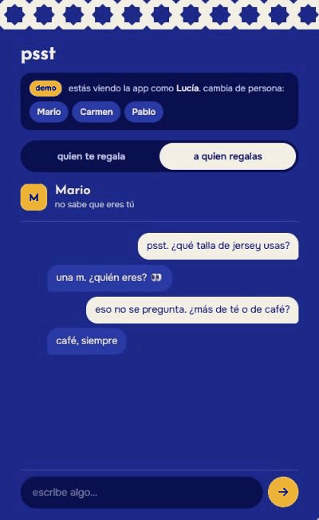
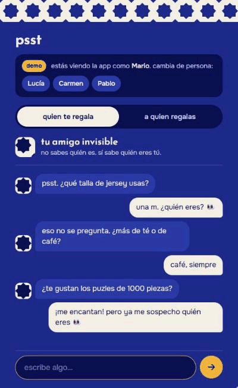
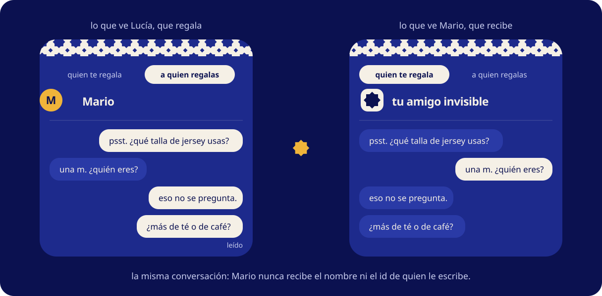
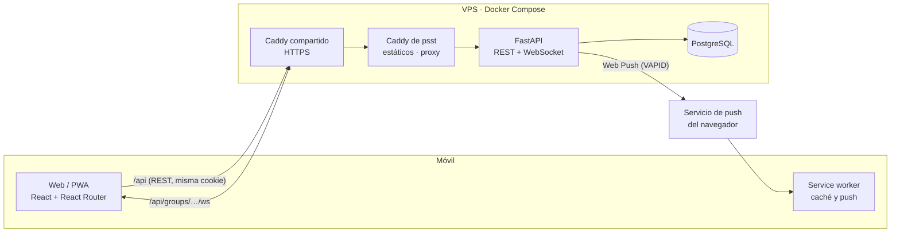

<div align="center">



<br>

[](https://github.com/aadolfo8/psst/actions/workflows/ci.yml)


**sin cuentas · sin email · sin teléfono**<br>
un enlace por WhatsApp, un nombre y un PIN de 4 cifras.

[por qué existe](#por-qué-existe) ·
[cómo funciona](#cómo-funciona) ·
[el anonimato](#el-anonimato) ·
[decisiones técnicas](#decisiones-técnicas) ·
[arrancarlo](#arrancarlo) ·
[la IA](#cómo-se-usó-la-ia)

</div>

<table>
  <tr>
    <td align="center" width="33%">
      <br>
      <sub>abres la celosía y ves a quién le regalas</sub>
    </td>
    <td align="center" width="33%">
      <br>
      <sub>el mismo chat visto desde los dos lados</sub>
    </td>
    <td align="center" width="33%">
      <br>
      <sub>al final se quitan las celosías y se sabe quién acertó</sub>
    </td>
  </tr>
</table>

<br>

## Por qué existe

Las webs de amigo invisible que ya existen resuelven el sorteo, pero casi todas piden
email a cada participante, cuenta para el organizador o meten anuncios. Y ninguna
resuelve lo difícil de verdad: **acertar con el regalo**. Le preguntas a otra persona
qué talla usa tu amigo invisible, se lo cuenta, y adiós secreto.

psst añade lo que faltaba: un **chat anónimo** entre quien regala y quien recibe.
Quien regala pregunta lo que quiera; quien recibe contesta sin saber a quién.

> [!TIP]
> En la página de inicio, **«probar la demo»** crea un grupo de ejemplo ya sorteado y
> te deja cambiar de persona para ver el anonimato desde los dos lados. Menos de un minuto.

## Cómo funciona


1. **Creas el grupo** con nombre, presupuesto y fecha. Tú también participas.
2. **Compartes el enlace** por WhatsApp con el mensaje ya redactado.
3. **Cada persona se une** con su nombre y un PIN, que le sirve para volver a entrar
   desde otro móvil.
4. Cada uno escribe su **lista de deseos**. El organizador añade **exclusiones**
   (parejas que no pueden tocarse), cierra las inscripciones y **hace el sorteo**.
5. Cada uno **abre su celosía**: ve a quién le regala y su lista de deseos.
6. **Chat secreto** con dos pestañas: «quien te regala» (anónimo) y «a quien regalas».
   Mensajes en vivo, «escribiendo…», «leído» y avisos push cuando no tienes la app abierta.

## El anonimato



<table>
<tr>
<th width="50%">cómo se garantiza</th>
<th width="50%">sus límites, con honestidad</th>
</tr>
<tr valign="top">
<td>

- Los mensajes no guardan quién los envía, solo su papel (`giver` o `receiver`).
  No hay un `sender_id` que se pueda filtrar por error.
- La API devuelve cada mensaje con `mine: true/false` en lugar de un remitente.
- Los eventos del websocket y el texto de las push no llevan ids ni nombres.
- Hay tests que recorren, en bruto, las respuestas REST y los eventos del websocket
  que recibe quien recibe y comprueban que no aparece nadie más del grupo. Otro
  comprueba que los avisos push no llevan nombres.

</td>
<td>

- **La forma de escribir delata.** Si tu hermano siempre escribe «jajajjaj», lo vas a
  reconocer. El «modo disfraz» con IA que reescribe en tono neutro queda para después.
- **En grupos pequeños se deduce.** Con tres personas, quien te regala es una de dos.
- **Las horas cuentan.** Si te escriben justo cuando alguien deja el móvil en la mesa…
- **Quien administra el servidor puede ver la base de datos**, como en cualquier
  servicio. La app no lo oculta a nivel criptográfico; lo oculta a todos los demás.

</td>
</tr>
</table>

## Arquitectura



- **Un solo origen.** La web llama a `/api` en su mismo dominio: en desarrollo lo
  reenvía el proxy de Vite y en producción Caddy. Sin CORS, y la cookie de sesión es
  de la web.
- **Escribir va por REST, recibir por websocket.** Enviar un mensaje o marcar leído son
  peticiones normales, con su validación y sus tests. El websocket solo *empuja* eventos
  (mensaje nuevo, leído, escribiendo…).
- **Push solo si hace falta.** Si la otra persona tiene el chat abierto, el mensaje le
  llega por el websocket. Si no, le llega una notificación push.

## Decisiones técnicas

| Decisión | Por qué |
|---|---|
| **FastAPI + PostgreSQL** (y no Mongo) | Los datos son relacionales: grupos, participantes, exclusiones y asignaciones. El sorteo necesita restricciones `unique` y transacciones, y la base de datos garantiza por sí misma que es una biyección. El chat no justifica una base documental: son cientos de mensajes por grupo. |
| **SPA con Vite** (y no Next.js) | La web vive detrás de una API propia y no necesita renderizado en servidor. En producción son estáticos servidos por Caddy, sin Node. |
| **PWA** (y no app nativa) | Se instala desde el navegador, sin tiendas, y llega por un enlace de WhatsApp. Las push funcionan en Android y, con la web instalada, en iPhone. |
| **Nombre + PIN** (y no teléfono o email) | Nadie quiere dar su teléfono para un amigo invisible. El PIN se guarda con argon2 y se bloquea 15 minutos tras 5 fallos, porque 4 cifras se prueban todas en minutos. |
| **WebSockets + push** | El websocket da el «escribiendo…» y el «leído» en vivo; la push cubre el resto del tiempo. Una conexión por persona, autenticada con la misma cookie y con comprobación del `Origin`. |
| **Sorteo por backtracking** | Aleatorio, sin autoasignaciones y respetando exclusiones simétricas. Si no hay solución, explica por qué («Ana no puede regalar a nadie con estas exclusiones»). Probado con tests de propiedades (Hypothesis). |
| **Tipos generados del OpenAPI** | El cliente TypeScript sale del esquema de FastAPI. Si la API cambia, la web no compila, y la CI comprueba que están al día. |

## Seguridad

- Sesión en cookie `httpOnly`, `SameSite=Lax` y `Secure` en producción, una por grupo.
  En la base de datos solo se guarda el SHA-256 del token.
- PIN con argon2 y bloqueo por intentos, con la fila bloqueada (`FOR UPDATE`) para que
  varios intentos a la vez no se salten el límite.
- Enlaces de grupo aleatorios de 10 caracteres con `secrets`, sin letras confusas.
- El websocket rechaza otros orígenes: sin esa comprobación, cualquier web podría
  abrirlo con tu cookie.
- Contenedores sin root y Postgres sin puertos publicados.

## Estructura

```
apps/
  api/                 FastAPI · SQLAlchemy async · Alembic · pytest
    app/routers/       grupos, sala, sorteo, chat, websocket, push y demo
    app/draw.py        el algoritmo del sorteo
    app/realtime.py    conexiones websocket abiertas (en memoria)
    app/push.py        envío de notificaciones
  web/                 Vite · React 19 · React Router 8 · CSS Modules
    src/pages/         pantallas
    src/sw.ts          service worker (caché y push)
    DESIGN.md          sistema visual: la celosía
deploy/                Caddyfile e imagen de la web (Caddy + estáticos)
docker-compose.production.yml   producción en el VPS (imágenes de ghcr.io)
.github/workflows/     CI y despliegue continuo
```

## Arrancarlo

<details>
<summary><b>desarrollo local</b></summary>

Requisitos: Node 22 con pnpm, [uv](https://docs.astral.sh/uv/) y Docker.

```bash
# Base de datos (Postgres 16 en el puerto 5433)
pnpm db:up

# API: http://localhost:8000, documentación en /docs
cd apps/api
cp .env.example .env
uv sync
uv run alembic upgrade head
uv run uvicorn app.main:app --reload

# Web: http://localhost:3000
pnpm install
pnpm dev:web
```

Para probar las push en local, genera unas claves con
`uv run python -m scripts.gen_vapid` y cópialas al `.env` de la API. Chrome de
escritorio permite push en `localhost` sin HTTPS.

Si cambias la API, regenera los tipos de la web con `pnpm gen:api`.

</details>

<details>
<summary><b>tests y CI</b></summary>

```bash
cd apps/api && uv run ruff check . && uv run ruff format --check . && uv run pytest
pnpm lint:web && pnpm typecheck:web && pnpm build:web
```

Los tests de la API usan la base de datos de desarrollo y **la vacían** al terminar
cada test. La CI de GitHub Actions ejecuta todo lo anterior, comprueba que las
migraciones están al día y que los tipos de la web corresponden a la API.

</details>

<details>
<summary><b>despliegue (CI/CD) y preparación del VPS</b></summary>

Producción: **https://psst.hidan.es**, en un VPS con Docker Compose y un Caddy
compartido (`/srv/proxy`) que es lo único que publica los puertos 80/443 y saca el
HTTPS. psst no publica puertos: su contenedor `web` (Caddy con la web compilada, que
reenvía `/api` y el websocket a FastAPI) se une a la red externa `proxy` con el alias
`psst-web` y escucha en el **8080**. La API (`psst-api`) y Postgres (`psst-db`) solo
están en la red privada de la app.

**Cómo se despliega.** Cada push a `main` pasa el CI (`.github/workflows/ci.yml`). Si
pasa, `deploy-production.yml`:

1. Construye las imágenes de la API y de la web en GitHub Actions (el VPS tiene poca
   RAM) y las publica en `ghcr.io/aadolfo8/psst-{api,web}` con el SHA del commit como tag.
2. Entra por SSH al VPS y, si ese commit no está ya desplegado, escribe el `.env` desde
   el secret `VPS_ENV_FILE`, hace `git fetch` + `checkout` del commit, `docker compose
   pull` + `up -d` y espera hasta 180 s a que todo esté *healthy*.
3. Si algo falla, vuelve al último commit desplegado con éxito (guardado en
   `/srv/psst/.deployed-sha`) y a sus imágenes.

> **Las migraciones tienen que ser compatibles hacia atrás.** La API aplica las
> migraciones al arrancar, y el rollback vuelve al código anterior pero **no las
> deshace**. Así que una migración nunca puede romper la versión anterior: primero se
> añade (columna nueva con valor por defecto o *nullable*) y solo en un despliegue
> posterior, cuando ningún código la use, se borra o se renombra lo viejo.

### Preparación del VPS (una sola vez)

**a. Carpeta y clon con una Deploy Key de solo lectura**, como el usuario `deploy`:

```bash
sudo install -d -o deploy -g deploy /srv/psst

# Clave de solo lectura para que el VPS clone el repo (también sirve si el repo es privado)
ssh-keygen -t ed25519 -N "" -C "psst VPS deploy key" -f ~/.ssh/psst_deploy_key
cat ~/.ssh/psst_deploy_key.pub
# → GitHub: repo → Settings → Deploy keys → Add deploy key, SIN "Allow write access"

cat >> ~/.ssh/config <<'CONF'
Host github-psst
  HostName github.com
  User git
  IdentityFile ~/.ssh/psst_deploy_key
  IdentitiesOnly yes
CONF

git clone git@github-psst:aadolfo8/psst.git /srv/psst
```

**b. DNS:** nada que hacer, el comodín `*.hidan.es` ya apunta al VPS.

**c. Sitio en el Caddy compartido.** Crear `/srv/proxy/sites/psst.caddy`:

```caddy
psst.hidan.es {
	encode zstd gzip
	reverse_proxy psst-web:8080
}
```

y recargar: `docker exec proxy-caddy-1 caddy reload --config /etc/caddy/Caddyfile`.
Hasta el primer despliegue Caddy dará 502, porque `psst-web` aún no existe.

### Secrets de GitHub (entorno `production`)

| Secret | Valor |
|---|---|
| `VPS_HOST` | IP o nombre del VPS |
| `VPS_USER` | `deploy` |
| `VPS_PORT` | puerto SSH del VPS |
| `VPS_DEPLOY_PATH` | `/srv/psst` |
| `VPS_SSH_PRIVATE_KEY` | clave privada cuya pública está en `~deploy/.ssh/authorized_keys` |
| `VPS_KNOWN_HOSTS` | salida de `ssh-keyscan -p <puerto> <host>` (comprueba la huella) |
| `VPS_ENV_FILE` | el `.env` de producción completo; plantilla en `.env.production.example` |

No hace falta ningún secret para ghcr: las imágenes se publican con el `GITHUB_TOKEN`, y
el VPS hace `docker login` con el token del propio job (caduca al terminar) y
`docker logout` al acabar.

### Operar a mano en el VPS

```bash
cd /srv/psst
export PSST_IMAGE_TAG=$(cat .deployed-sha)   # el compose lo necesita para saber qué imágenes
docker compose -f docker-compose.production.yml ps
docker compose -f docker-compose.production.yml logs -f api

# Copia de seguridad de la base de datos
docker compose -f docker-compose.production.yml exec db pg_dump -U psst psst > psst-$(date +%F).sql
```

> **Un solo worker.** Las conexiones websocket viven en la memoria del proceso. Para
> escalar a varios workers o máquinas, los eventos tendrían que pasar por
> `LISTEN/NOTIFY` de Postgres o por Redis pub/sub. Para grupos de amigos, sobra.

</details>

## Cómo se usó la IA

El proyecto se construyó con [Claude Code](https://claude.com/claude-code) como
compañero de programación, con estas reglas:

- **Primero la especificación.** `CLAUDE.md` recoge el brief, el modelo de datos, las
  decisiones de stack y un plan en fases, cada una con un resultado verificable.
- **Fase a fase.** Antes de cada fase, un plan breve que yo confirmo. Un commit por fase,
  y no se avanza sin cumplir el resultado verificable.
- **Las decisiones son mías.** Cuando había que elegir (una conexión websocket por
  persona o por conversación, enviar por REST o por socket, si la push lleva el texto
  del mensaje…), la IA proponía opciones y yo decidía.
- **Código explicable.** Prioridad a soluciones simples y legibles sobre las ingeniosas,
  porque tengo que poder defender cada línea.
- **Los tests como contrato.** Sobre todo los del sorteo y los del anonimato.

<!-- Añadir aquí: qué hice yo a mano, dónde se equivocó la IA y qué aprendí. -->

## Probado con un grupo real

<!-- Pendiente: notas del primer grupo real antes de Navidad. -->
Pendiente.

---

<div align="center">
<br>
<sub>añil, cal y albero</sub>
</div>
